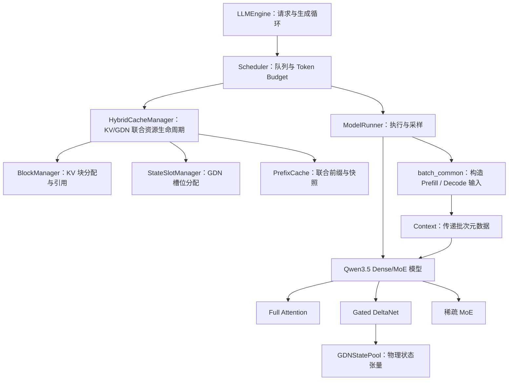
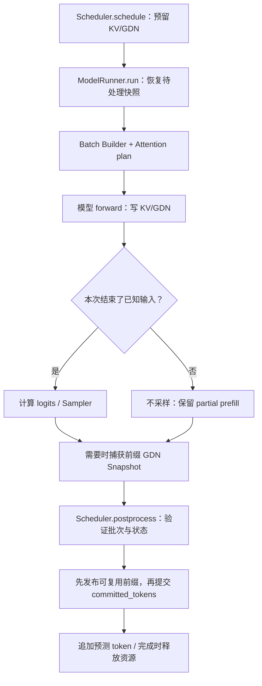

# 模型与运行时架构

本章解释模型计算、Batch Layout 与物理状态。调度和失败策略见[调度文档](scheduling.md)。

## 一个 decoder 层做什么

[Qwen3_5DecoderLayer](../nanovllm/models/qwen3_5.py)按 `config.layer_types[layer_idx]` 选择序列算子，每层使用 GDN 或 Full Attention 之一，然后按模型类型执行 MoE 或稠密 FFN：

```text
输入 hidden states
  → RMSNorm
  → Gated DeltaNet 或 Full Attention
  → 加回残差
  → RMSNorm
  → 稀疏路由专家 + 带门控的共享专家，或稠密 SwiGLU FFN
  → 加回残差
  → 下一层
```

层的排列来自模型配置，文档不假定固定间隔。整个模型在 decoder 层之前做 embedding，在最后做 RMSNorm；只有需要采样的位置才进入 `lm_head` 计算 logits。

### Full Attention：保留可寻址的历史 K/V

实现入口：[Qwen3_5Attention](../nanovllm/models/qwen3_5_layers.py)、[Attention](../nanovllm/layers/attention.py)。

1. 从输入投影出 Q、K、V，以及输出门控值。
2. 对 Q/K 做模型规定的 RMSNorm，并对部分维度应用 RoPE。
3. 把新 K/V 写入对应的物理 KV 槽位。
4. 当前 Q 与有效历史 K/V 计算因果注意力。
5. 注意力输出乘以 `sigmoid(gate)`，再做输出投影。

这里的 Qwen3.5 RMSNorm 使用 `1 + weight` 作为缩放系数，不能与普通 `weight` 缩放的 RMSNorm 随意互换。GDN 内部的 `RMSNormGated` 另有自己的权重与 SiLU 门控语义。

Full Attention 的 KV 总量随上下文长度增长。分页只改变存储和寻址方式，并没有让每次 decode 不再读取历史。

### Gated DeltaNet：把历史压入固定状态

实现入口：[GatedDeltaNet](../nanovllm/layers/gated_delta_net.py)。

```text
输入投影
  → 使用历史状态的因果逐通道卷积
  → 拆分 Q/K/V，归一化 Q/K
  → Prefill 按 64-token 块计算 delta-rule；Decode 执行递归更新
  → 带门控的 RMSNorm
  → 输出投影
```

每个活动请求在每个 GDN 层保存两类历史：

| 状态 | 保存的内容 | 活动状态 dtype |
| --- | --- | --- |
| `conv_state` | 因果卷积需要的近期投影输入 | 跟随模型 dtype |
| `recurrent_state` | delta-rule 累积的矩阵 | FP32 |

忽略批维度和头维度，把归一化后的 q/k 看成列向量，代码中的单步更新可写为：

```text
S_decay = exp(g_t) × S_previous
memory  = S_decay × k_t
delta   = beta_t × (v_t - memory)
S_new   = S_decay + delta × transpose(k_t)
output  = S_new × q_t
```

其中 `beta_t = sigmoid(b_t)`，`g_t = -exp(A_log) × softplus(a_t + dt_bias)`；q 在归一化后还乘以 `head_k_dim ** -0.5`。直观上，先衰减旧状态，再用当前 value 与旧记忆的差修正状态，最后读取输出。

等长多请求 Prefill 的卷积直接用 `causal-conv1d` 原生 Batch + `initial_states` / `return_final_states`，不再显式拼接每段历史或二次拼接输出。变长请求仍走历史窗口的 Packed 单 Kernel 路径；两者均保持每请求独立的卷积状态。

单层活动循环矩阵的形状是 `[num_value_heads, value_head_dim, key_head_dim]`，不随序列长度增长。卷积状态也固定大小。不过本模型仍有 Full Attention 层，因此整个请求的显存并非与上下文长度无关。

GDN Prefill/Decode 固定使用 FlashInfer 0.7.0 的 Indexed 算子，要求 GPU 为 SM90/100/120、模型 dtype 为 BF16 且 K/V head_dim 均为 128；不满足时在初始化阶段报错。循环状态统一维护 FP32 `[V,K]` 布局，不保留 PyTorch GDN 计算回退。

调度层的“分块 prefill”仍表示分几轮执行输入，与算子内部的 chunk 64 分别处理。非零历史状态、变长请求和前缀快照沿用原接口。不同调度分块会改变 FP32 舍入顺序，不能要求任意分块方式都逐位相同。Decode 保留现有向量化递归路径；分块递推与 HF 数学等价但运算顺序不同，不保证逐位一致，也不代表完整模型已与 HF 对齐。

### 稀疏 MoE：只计算被选中的专家

实现入口：[Qwen3_5MoeTopKRouter / Qwen3_5MoeExperts / Qwen3_5SparseMoeBlock](../nanovllm/models/qwen3_5_moe.py)。

每个 token 的路由过程是：

```text
router logits → FP32 softmax → Top-K → 对选中权重重新归一化
             → 各选中专家计算 → 按路由权重累加
             → 加上 sigmoid(shared_gate) × shared_expert
```

假设一个 token 的四个专家概率为 `[0.5, 0.3, 0.15, 0.05]`，选择 Top-2，则选中专家的混合权重为 `[0.625, 0.375]`。共享专家另行计算，不占这两个路由名额。

专家参数保持打包的三维张量（加载时将检查点的 `[gate, up]` 调整为 `[up, gate]`）；Prefill 与 Decode 都直接调用 FlashInfer CUTLASS Fused MoE。共享专家仍走独立的 SwiGLU 路径。

### 稠密 FFN：复用混合主干

[Qwen3_5ForCausalLM](../nanovllm/models/qwen3_5.py) 是共享主干的薄适配层。`qwen3_5_text` 的每层 FFN 使用已有 `Qwen3_5MLP` 的三个普通 Linear：`down_proj(silu(gate_proj(x)) * up_proj(x))`，宽度来自 `intermediate_size`。不创建 router、专家张量或 MoE 工作空间。GDN、Attention、Norm、调度与缓存接口沿用同一实现。

MLP 直接创建融合后的 `gate_up_proj`；严格加载器将 HF `gate_proj`、`up_proj` 分片写入对应行，并用 FlashInfer `silu_and_mul` 计算稠密 SwiGLU。若配置启用 `tie_word_embeddings`，embedding 与 `lm_head` 共享同一个参数；严格加载器按参数身份合并别名，仍拒绝缺失 FFN 权重或相互冲突的共享权重。

## 一个请求有两种物理历史

| 资源 | 管理对象 | 大小与共享方式 |
| --- | --- | --- |
| Full Attention KV | `BlockManager` | 按固定容量块增长，完整前缀块可共享并计数引用 |
| 活动 GDN 状态 | `StateSlotManager` + `GDNStatePool` | 每个请求独占一个逻辑槽位，各 GDN 层用相同槽号索引 |
| 可复用联合前缀 | `HybridCacheManager` + `PrefixCache` | 完整 KV 块引用与同边界的 GDN CPU 快照保存在同一 prefix entry；卷积保持活动 dtype，循环矩阵保持 FP32 |

核心约束是：**用于继续计算的 KV 历史和 GDN 状态必须表示同一段 token 前缀。** 稳定的已提交状态可以表示为：

```text
KV 的有效前缀长度 = GDN 的有效前缀长度 = Sequence.committed_tokens
```

这个等式描述有效历史，不表示物理缓冲区的总容量相同。执行中的状态可以暂时超过已提交边界；命中前缀后，GDN 也可以先以 `pending_state_snapshot` 形式等待恢复。运行时必须在下一次前向读取状态前完成恢复，并在执行成功后提交新边界。

## Sequence 中最重要的字段

源码：[Sequence](../nanovllm/engine/sequence.py)。

| 字段 | 作用 |
| --- | --- |
| `token_ids` | 已知的输入与生成 token；`len(seq)` 与 `seq[-1]` 直接读取该列表 |
| `num_prompt_tokens` | 原始输入长度，用于区分 prompt 和 completion |
| `committed_tokens` | 两种历史共同表示的已提交长度 |
| `block_table` | 请求的逻辑块到物理 KV 块的映射 |
| `state_slot` | GDN 活动槽号，`-1` 表示尚未拥有槽位 |
| `pending_state_snapshot` | 命中前缀后，等待写入设备槽位的 GDN 快照 |

本轮安排由 [ScheduledChunk](../nanovllm/engine/schedule.py) 独立记录 `[start,end)`，执行成功后 `committed_tokens` 才推进到 `end`。

例如，长度为 3 的 prompt 完成 prefill 并生成第一个 token 后，`num_tokens=4`，但 `committed_tokens=3`。下一个 decode 会把第 4 个 token 送进模型，再生成第 5 个。这里的“少一个”是自回归生成的正常语义。

## 运行时调用关系



图中的管理关系不代表每个节点都会逐个调用后续所有节点。实际执行顺序是：调度 → 必要的状态恢复 → 构造输入 → 模型 → 采样/快照 → 后处理提交。

| 文件 | 职责 |
| --- | --- |
| [llm_engine.py](../nanovllm/engine/llm_engine.py) | API、请求校验、生成循环和执行失败后的关闭 |
| [scheduler.py](../nanovllm/engine/scheduler.py) | 调度预算、请求队列及调用资源接口完成状态提交 |
| [schedule.py](../nanovllm/engine/schedule.py) | 保存本轮执行区间及执行结果 |
| [hybrid_cache_manager.py](../nanovllm/engine/hybrid_cache_manager.py) | 统一 KV/GDN 准入、生命周期 Snapshot 发布与引用释放 |
| [block_manager.py](../nanovllm/engine/block_manager.py) | KV Block 分配与共享前缀引用 |
| [state_manager.py](../nanovllm/engine/state_manager.py) | GDN 状态槽分配 |
| [prefix_cache.py](../nanovllm/engine/prefix_cache.py) | KV Block Hash 与 GDN 状态联合匹配、全局冷优先 FIFO 淘汰 |
| [decode_graph.py](../nanovllm/engine/decode_graph.py) | Decode CUDA Graph bucket |
| [batch_common.py](../nanovllm/engine/batch_common.py) | 统一准备 Prefill / Decode 的元数据与输入张量 |
| [context.py](../nanovllm/utils/context.py) | 将单次 forward 的元数据传给模型层 |
| [cache_runtime.py](../nanovllm/engine/cache_runtime.py) | 分配物理 KV/GDN 张量并恢复 GDN 快照 |
| [model_runner.py](../nanovllm/engine/model_runner.py) | 构造模型、静态缓存分配、前向、采样和批量快照捕获 |
| [attention.py](../nanovllm/layers/attention.py) | FlashInfer Paged Attention 元数据规划及 KV 写入/计算 |

`Context` 是当前批次的临时元数据，不拥有长期请求状态。Prefill/Decode batch builder 将它与输入张量一起返回；`ModelRunner.run()` 在作用域内安装上下文，退出作用域时恢复原值。

## 变长打包到底打包了什么

假设本轮有两个已分配资源的请求：A 已提交 16 个 token，再计算 3 个；B 从头计算 2 个。

```text
input_ids         = [A16, A17, A18, B0, B1]   # 下标从 0 开始
positions         = [ 16, 17, 18,  0,  1]
q_offsets                = [0, 3, 5]
kv_lens                  = [19, 2]
paged_kv_indptr          = [0, 2, 3]      # 假设 page size = 16
paged_kv_indices         = [A0, A1, B0]   # 物理页号
paged_kv_last_page_len   = [3, 2]
state_prefix_lens        = [16, 0]
state_slots              = [A 的槽号, B 的槽号]
```

A 的 query 长度是 3，它能读取的 KV 长度是历史 16 加本轮 3，共 19；B 的 query/KV 长度均为 2。`paged_kv_indptr/indices/last_page_len` 用 CSR 形式描述每个请求实际占用的物理 KV 页。

必须保持下面的第 i 个请求对齐关系：

```text
q_offsets[i:i+2]
    ↔ paged_kv_indptr[i:i+2] 对应的物理页
    ↔ state_slots[i]
    ↔ state_prefix_lens[i]
```

ModelRunner 每个 batch 只调用一次 FlashInfer `plan()`，各 Full Attention 层复用同一个 wrapper；GDN 继续用 query 偏移拆出请求片段并选择各自状态槽。把两个请求直接当成一条长序列计算，会错误地串联历史。

真实 Prefill 和 Decode 始终通过 FlashInfer 访问分页 KV，GDN 使用持久 State Slot。启动阶段不再运行无缓存 SDPA 或临时 GDN Forward；缺少所需物理资源会直接报错。新 K/V 通过 FlashInfer `append_paged_kv_cache` 写入：`kv_batch_indices` 标识每行所属请求，`kv_positions` 给出该请求内的逻辑 token 位置，分页 CSR 元数据提供物理页映射。对逻辑 token 位置 p、块容量 B，FlashInfer 内部按如下关系寻址：

```text
逻辑块号 = p // B
块内偏移 = p % B
物理槽号 = block_table[逻辑块号] × B + 块内偏移
```

首次 Prefill 同样通过 FlashInfer Paged Attention 计算，并将本轮 K/V 写入对应物理页，供后续 Chunk 和 Decode 使用。

KV 的逻辑位置与 mRoPE 三轴位置分别维护：图片展开可能改变 RoPE 坐标，但不能改变 KV 在序列中的 token 下标。FP8 写入前用 PyTorch 在 FP32 中除以 K/V scale、裁剪到 `[-448,448]` 并转换为 E4M3；Attention 读取时仍使用同一组反量化 scale。普通 KV 路径直接追加原 dtype 的 K/V。Decode Graph 为追加请求编号、逻辑位置与页表预分配固定地址缓冲区，Replay 前只更新缓冲区内容。

## 启动时怎样分配缓存

[ModelRunner](../nanovllm/engine/model_runner.py)先加载模型并调用 `eval()`，由 [allocate_runtime_caches()](../nanovllm/engine/cache_runtime.py)根据 `gpu_memory_utilization` 和当下已使用显存计算静态 KV 预算，同时扣除 `max_num_seqs` 个 GDN 槽位、启用前缀缓存且快照预算充足时的 GDN Snapshot Staging 工作区，以及启用视觉模式时的视觉特征预留、每个 Decode Graph Bucket 的固定空间估算及额外 `activation_reserve_bytes`（默认 256 MiB）。不再运行模型来测量历史激活峰值，剩余显存作为 Prefill、MoE、Vision 临时激活和 Graph Capture 的余量；这不是 OOM 安全证明。

```text
GPU_used = total_GPU_memory - CUDA_free_at_allocation
KV_budget = floor(total_GPU_memory × gpu_memory_utilization)
            - GPU_used - GDN_pool_bytes - snapshot_staging_bytes
            - visual_feature_reserve_bytes - graph_reserve_bytes
            - activation_reserve_bytes
KV_blocks = floor(KV_budget / KV_block_bytes)
```

默认 `gpu_memory_utilization=0.8`，代表在计算 KV 容量时保留总显存约 20% 的预算空间，不等于所有临时张量之和最多使用 20%。模型首次运行的计算开销随 Prefill Token 数、Decode Batch、MoE 路由与图片输入变化。物理 KV Pool 在启动时整体创建，但 `BlockManager` 只在请求需要时分配/归还**逻辑 Block**；如果尝试按需扩容物理 KV Tensor，还需重做页地址、Graph Capture 和显存竞争的管理，因此不作为当前设计目标。

每个物理块跨全部 Full Attention 层所占字节数为：

```text
2 × Full Attention 层数 × 块内 token 数
  × KV head 数 × head_dim × KV 元素字节数
```

开头的 `2` 代表 K 和 V。每个 GDN 层的槽池包含：

```text
conv_state      [槽数, conv_dim, conv_kernel_size - 1]
recurrent_state [槽数, value_heads, value_head_dim, key_head_dim]
```

`eval()` 设置模块推理行为，`torch.inference_mode()` 关闭前向中的训练追踪。后者不妨碍 KV/GDN 张量就地更新。它们是推理执行设置，不会把参考算子自动融合成高性能 kernel。

## 权重加载为什么严格

[load_model()](../nanovllm/utils/loader.py)读取目录下的 safetensors 分片，按模型声明的规则改名、跳过无关权重，再逐项检查名称和形状：

- `model.language_model.` 映射到 `model.`；启用视觉模式时 `model.visual.` 映射到 `visual.`，纯文本模式跳过视觉权重；
- 跳过 `mtp.` 前缀；
- 遇到未知参数、形状不匹配或缺失参数时抛出异常。

这样可以尽早发现检查点与适配器不匹配。启用视觉模式后支持单图：视觉塔权重被加载，`encode_image()` 生成视觉特征；`mtp.` 权重因没有 MTP 执行路径而跳过。

继续阅读[调度与混合状态管理](scheduling.md)，可以看到上述物理历史怎样在请求的完整生命周期中保持一致。

## 从 API 到执行：逐步跟踪请求

以下路径针对当前实现的实际函数，补充前面各组件的调用关系。先按单请求理解逻辑提交，再观察打包、混合算子及恢复语义。

### 1. 启动时先建立哪些资源

[LLMEngine.__init__()](../nanovllm/engine/llm_engine.py) 先根据 [Config](../nanovllm/config.py) 建立运行时，随后初始化 [ModelRunner](../nanovllm/engine/model_runner.py) 与 Scheduler。ModelRunner 的 GPU 初始化顺序是：

```text
构建 Qwen3_5ForCausalLM → 严格加载 safetensors → model.eval()
  → MoE 模型初始化 FlashInfer CUTLASS workspace（Dense 跳过）
  → 建立 Prefill / Decode FlashInfer Attention wrapper
  → 按静态显存预算分配 KV Cache 与 GDN State Pool
  → 按配置捕获 Decode CUDA Graph bucket（预执行一次，再清理/捕获）
```

Attention Prefill/Decode wrapper 共享调用方管理的 workspace，两个阶段顺序执行。静态预算根据模型等已占用显存和 `max_num_seqs` 个 GDN 活动槽等保留资源来定容；临时张量使用 `gpu_memory_utilization` 外的显存余量，未通过启动运行来测量。初始化之后 Scheduler 才能依据真实 KV 块容量预留资源。这里只是启动顺序，不代表模型、工作空间或全部状态能在任意显卡上放下。

### 2. 一个请求如何进入生成循环

```text
generate(prompts, sampling_params) 或 add_request(prompt, params)
  → LLMEngine._prepare_request()
      文本 tokenize；ImagePrompt 通过 AutoProcessor 展开
      检查 max_model_len 与物理 KV 容量
      构建 Sequence(token_ids, committed_tokens=0)
  → Scheduler.add()：加入 waiting
  → LLMEngine.step()：Scheduler.schedule()
      生成 decode_chunks / prefill_chunks
  → LLMEngine._run_batch()
      ModelRunner.run() → Scheduler.postprocess()
  → 返回本轮完成请求的 token_ids；未完成请求继续调度
```

`generate()` 要求进入时引擎空闲，运行到当前请求全部完成并按输入顺序收集结果；需要外部逐步加入请求时使用 `add_request()/step()`。二者共享 Scheduler / ModelRunner。持续批处理中的请求动态加入和退出队列，与一次 `generate()` 的输入批量是两个概念。

`Sequence` 保存已知 `token_ids`、prompt 长度、`committed_tokens`、KV `block_table`、`state_slot` 和可选的 `pending_state_snapshot`。其中 `committed_tokens` 表示 **KV 与 GDN 都已完成的逻辑历史长度**；已生成但尚未作为输入计算的 token 会留在 `token_ids` 末尾。

### 3. 五个 token 的完整 Prefill → Decode 轨迹

假设 prompt 为 `[a,b,c]`，最多生成 2 个 token（`d,e`），没有 EOS 提前结束、前缀命中或抢占：

| 阶段 | `token_ids` | `committed_tokens` | 处理的区间 | 说明 |
| --- | --- | ---: | --- | --- |
| 入队 | `[a,b,c]` | 0 | — | waiting，尚无已提交历史 |
| 安排 Prefill | `[a,b,c]` | 0 | `[0,3)` | 预留 KV 与 GDN Slot |
| Prefill forward | `[a,b,c]` | 0 | `[0,3)` | 已写物理 KV/GDN，尚未逻辑提交 |
| Prefill postprocess | `[a,b,c,d]` | 3 | — | 提交三 token 历史，首次采样得到 d |
| Decode forward | `[a,b,c,d]` | 3 | `[3,4)` | 把 d 作为模型输入，预测 e |
| Decode postprocess | `[a,b,c,d,e]` | 0 | — | 输出达到上限；完成并释放资源，重置边界 |

`committed_tokens=0` 的最后一行发生在完成请求的资源回收阶段；它不否定刚执行的 decode。最后生成的 `e` 不需要再前向一次。更一般地，**最后一次完成的 Prefill 能直接产生首个输出 token**；部分 Prefill Chunk 只推进历史，不做采样。

如果 prompt 长度 40、预算为每轮 16，Prefill 分别提交 `[0,16)`、`[16,32)`、`[32,40)`，只有最后一个 Chunk 采样。对应的请求 GDN Slot 跨 Chunk 保持不变，KV 块按需增长。

### 4. ModelRunner 每次 forward 具体准备什么

[ScheduledChunk](../nanovllm/engine/schedule.py) 是不可变的 `(seq,start,end)`，把本轮计划与请求的长期状态分开。两条 Batch 路径有不同的张量契约：

| 数据 | Prefill：`prepare_prefill()` | Decode：`prepare_decode()` |
| --- | --- | --- |
| 输入 | 按 Chunk 拼接的 token | 每个请求最后一个已知 token |
| 位置 | 各请求绝对三轴 mRoPE 位置 | 每请求一个绝对位置 |
| Attention | `q_offsets/qo_indptr` + Paged KV CSR | 每请求一个 query + Paged KV CSR |
| KV 写入 | 每个新 token 的 `kv_batch_indices` / `kv_positions` + Paged KV CSR | 每请求一个逻辑写入位置 + Paged KV CSR |
| GDN | `state_slots`、`state_prefix_lens`、`prefill_q_offsets` | 设备端 `state_slot_ids` |
| 图片 | Chunk 与视觉区间的 `image_copy_spans` | 没有待展开的图片区间 |

在 [ModelRunner.run()](../nanovllm/engine/model_runner.py) 中，首先将待恢复 GDN 快照写回活动槽；Decode 会先尝试匹配已捕获的 CUDA Graph bucket，不匹配则走 Eager。Eager Batch 用 [Context](../nanovllm/utils/context.py) 将 Paged KV 元数据和状态槽传递给模型层。

`_plan_attention()` 在每次常规 Batch 调用时对对应 FlashInfer wrapper 执行一次 `plan()`，并由所有 Full Attention 层复用该计划。Eager 模式将 `qo_indptr`（仅 Prefill）、`paged_kv_indptr`、`paged_kv_last_page_len` 保留为 pinned CPU 输入，由 FlashInfer 0.7.0 的 `plan()` 生成 GPU 缓冲，随后供 GDN 与 KV Append 共用，避免提前执行重复 H2D；页索引则沿用单份 GPU Tensor。CUDA Graph 仍使用固定设备缓冲。参数规格由 `flashinfer_attention_spec()` 提供；各层仍拥有自身的物理 KV 数据。GDN Prefill 按 `q_offsets` 拆开不同请求的 token 段，读取各自 Slot，依次推进卷积与循环状态。**Packed 输入只拼接计算张量，不合并不同请求的历史。**

三种实际执行路径的差异限定在准备与执行层：普通 Prefill 采用变长打包和 FlashInfer Paged Prefill；Eager Decode 每请求一个 token，使用 FlashInfer Paged Decode；可选 CUDA Graph Decode 复用固定输入地址和预捕获的模型前向。未配置的 Decode Batch Size 使用 Eager；已配置的 Graph Bucket 如果布局超出容量，同样回退 Eager；Plan 或 Replay 过程中出现异常时才将异常向上传播。三条路径都依赖同一组物理 KV/GDN Pool，**没有启动时无缓存 SDPA/GDN 参考路径**。

图片请求复用同一 Prefill 过程。`ImagePrompt` 在入队时由 Processor 展开 token 和三轴位置；当 Chunk 与图像 token 区间相交时，ModelRunner 按需调用 `encode_image()`，把对应的视觉特征切片写入 `inputs_embeds`。编码完成后释放 CPU pixel_values；Prefill 提交越过图像区间后释放 GPU 视觉特征，三轴位置信息保留到请求结束；当前仅支持单图。

### 5. 采样、Snapshot 与提交的相对顺序



[Scheduler.postprocess()](../nanovllm/engine/scheduler.py) 先检查结果数量，再逐个校验 Chunk、发布该请求的联合前缀并提交 `committed_tokens`；需要时追加预测 token、判断 EOS / 输出上限并释放资源。后续请求处理失败会使 Engine 失效，已提交的请求不再回滚。

一次 `step()` 可以同时包含 Decode 与 Prefill，但会按 **Decode forward → Decode postprocess → Prefill forward → Prefill postprocess** 两次执行。前一批成功提交后，后一批失败不会撤回前一批。

### 6. 资源不足、执行失败与联合前缀命中

| 事件 | 触发位置 | 当前恢复语义 |
| --- | --- | --- |
| KV/GDN 资源不足 | `Scheduler.schedule()` | 按完整生命周期 KV 页额度及 GDN 槽位准入；已接纳请求不足时淘汰缓存 |
| 已接纳请求 KV 扩容不足 | `Scheduler.schedule()` | 仅淘汰可回收的缓存条目；不抢占已接纳请求，仍不足则报告内部额度异常 |
| 模型前向、Graph 或提交失败 | `LLMEngine.step()` | 标记引擎不可继续使用并上抛原异常；不进行跨 Step 输出补发或 GPU 状态回滚 |
| 联合前缀命中 | `HybridCacheManager.admit()` | 挂接共享 KV、分配独占 GDN Slot、设置 `pending_state_snapshot`；下次 Prefill forward 前恢复到同一 token 边界 |
| 请求正常完成 | `Scheduler.postprocess()` | 释放请求 KV 引用与 GDN Slot；视觉特征可在图像区间 Prefill 完成后提前释放，缓存自身的独立 KV 引用仍可存在 |

共享 KV 使用引用计数：释放一个请求不一定让物理页空闲。GDN Slot 不在请求之间共享；可复用的是 CPU 上与整块 KV 前缀边界绑定的 GDN Snapshot。前缀缓存不保存下一 token logits，因此命中后至少保留一个已知 token 用于重新计算。

更细的额度准入、前缀发布条件、引用计数及失败路径分别见 [调度与缓存](scheduling.md)。数值等价需要独立验证，不能仅凭数据结构推断恢复无误。逐层诊断通过正常 `LLM.generate()` 配合 Forward Hook 捕获层输出，不再由探针直接调用 `model_runner.run()` 绕过请求提交。

### 7. 按问题阅读代码和测试

| 想回答的问题 | 源码入口 | 对应测试 |
| --- | --- | --- |
| 生成的 token 为什么落后于物理状态一位？ | [sequence.py](../nanovllm/engine/sequence.py) → [scheduler.py](../nanovllm/engine/scheduler.py) | [test_scheduler.py](../tests/unit/test_scheduler.py) |
| 两个请求 Packed 后如何保证历史隔离？ | [batch_common.py](../nanovllm/engine/batch_common.py) → [gated_delta_net.py](../nanovllm/layers/gated_delta_net.py) | [test_prefill_batch.py](../tests/unit/test_prefill_batch.py) |
| KV/GDN 怎样联合预留和释放？ | [scheduler.py](../nanovllm/engine/scheduler.py) → [state_manager.py](../nanovllm/engine/state_manager.py) | [test_scheduler.py](../tests/unit/test_scheduler.py) |
| 为什么缓存命中后还需要执行 Prefill？ | [prefix_cache.py](../nanovllm/engine/prefix_cache.py) → [cache_runtime.py](../nanovllm/engine/cache_runtime.py) | [test_scheduler_prefix_cache.py](../tests/unit/test_scheduler_prefix_cache.py) |
| Graph 未命中或 replay 报错会怎样？ | [decode_graph.py](../nanovllm/engine/decode_graph.py) → [model_runner.py](../nanovllm/engine/model_runner.py) | [test_model_runner.py](../tests/unit/test_model_runner.py) |
| 单图跨 Chunk 的特征如何对齐？ | [request.py](../nanovllm/multimodal/request.py) → [batch_common.py](../nanovllm/engine/batch_common.py) | [test_multimodal.py](../tests/unit/test_multimodal.py) |

阅读时重点检查四项：请求的 `committed_tokens`、KV `block_table`、GDN `state_slot`、待恢复 `pending_state_snapshot`。它们决定下一次 forward 能否读取一致的历史；性能优化不得改变这一契约。
