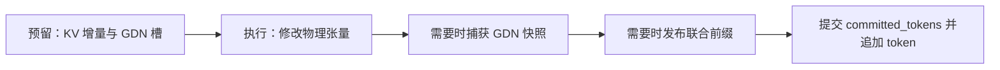

# 调度、缓存与混合状态

## 一轮调度与一次前向不同

[Scheduler.schedule()](../nanovllm/engine/scheduler.py)返回 `SchedulerOutput`，分别保存 `decode_chunks` 和 `prefill_chunks`。每个不可变的 `ScheduledChunk` 给出请求及本轮 `[start,end)`；两类工作共享 `max_num_batched_tokens` 和请求数量限制。

调度顺序为：

1. 从运行队列中选择 decode 请求，每个请求计入 1 个 token。
2. 选中的请求放到运行队列尾部，下一轮继续轮转。
3. 用剩余预算优先继续已经接纳的 Partial Prefill，再按 FIFO 接纳新请求。混合 Decode 轮次额外受 `max_mixed_prefill_tokens` 限制（默认 128，`None` 可关闭）。
4. 新请求在 Prefill 前按 `ceil((prompt_len + max_tokens - 1) / block_size)` 预留完整生命周期的逻辑 KV 页，同时遵守 GDN Slot 数量上限。

[LLMEngine.step()](../nanovllm/engine/llm_engine.py)随后先执行 decode forward，再执行 prefill forward。**一个调度轮次可以包含两类工作，但当前没有把它们合成一次混合 forward。**

### 预算示例

假设预算为 8 个 token、最多 4 个请求，运行队列有 A/B/C 三个 decode 请求，等待队列有长输入 D：

| 请求 | 本轮工作 | 消费 token | 消费请求名额 |
| --- | --- | ---: | ---: |
| A | decode | 1 | 1 |
| B | decode | 1 | 1 |
| C | decode | 1 | 1 |
| D | prefill chunk | 最多 5 | 1 |

即使 D 有数千个输入 token，本轮也只预留并执行能安排的片段。

如果只有 2 个 token 预算、运行队列为 `[A,B,C]`，第一轮选中 A/B 后队列成为 `[C,A,B]`；下一轮优先轮到 C。这个公平性只针对已经进入 decode 队列的请求，不保证等待中的 prefill 不会被持续的 decode 压力延后。

## 分块 prefill 如何保持连续

本轮请求片段使用半开区间：

```text
start = committed_tokens
q_len = min(尚未计算的 token 数, 剩余预算, KV 可容纳的新增 token 数)
end   = start + q_len
执行 token_ids[start:end]
```

KV 只增长到容纳 `end` 所需的块数；GDN 始终沿用该请求的同一槽号。部分 prefill 的请求保存在已接纳 Prefill 队列，并且仍然占有资源。

以 40-token 输入、每轮可用预算 16、块容量 16 为例，假设没有命中缓存且资源充足：

| 轮次 | 输入位置 | 成功后 committed | 请求持有 KV 块数 | GDN 槽 | 是否采样 |
| --- | --- | ---: | ---: | --- | --- |
| 1 | `[0,16)` | 16 | 1 | 同一个槽 | 否 |
| 2 | `[16,32)` | 32 | 2 | 同一个槽 | 否 |
| 3 | `[32,40)` | 40 | 3 | 同一个槽 | 是，生成首个 token |
| 4 | 位置 40 的首个生成 token | 41 | 3 | 同一个槽 | 是，生成第二个 token |

第 3 轮后，`num_tokens=41`，`committed_tokens=40`。部分 chunk 不会生成可交给用户的 token；只有所有已知输入都处理完，`ModelRunner._sample_logits()` 才选中该请求采样。

同一请求本轮只安排一个 chunk；资源充足时调度器继续扫描其他等待请求。已经接纳的请求保持逻辑 KV 额度，KV 页仍按需物理分配。资源充足时多个请求可以并行 Prefill；不足时新请求等待，不会抢占已有请求。

## 预留、执行、提交是三个阶段



### 资源预留

Scheduler 按全生命周期 KV 页额度及 GDN 槽位准入新请求。已接纳请求按当前 Chunk 按需分配 KV 页，额外的前缀缓存引用可通过淘汰能够释放独占 KV 页的条目回收；额度不足的新请求继续等待。

### 执行成功：推进一个共同边界

`postprocess()`检查批次结果数量与采样结果，在需要时发布联合前缀，随后提交逻辑进度并追加预测 token：

```text
check result count
  → sampling-result validation
  → publish this chunk's KV/GDN prefix if needed
  → committed_tokens = ScheduledChunk.end
  → append sampled token if applicable
```

不提供批次级回滚：后续 Chunk 失败时，前面请求可能已经提交。Engine 会终止后续执行；新生成的 token 尚未被前向处理，不属于刚发布的 KV/GDN 前缀。

## 为什么无需常规抢占

接纳请求时预留其最大生命周期所需 KV 页额度；活动请求预留量之和不能超过物理 KV 总页数。GDN Slot 同样在接纳时占用，请求完成时与 KV 页一并释放。前缀缓存额外持有的 KV 引用在空间紧张时优先淘汰能够释放独占 KV 页的条目；共享页的引用计数继续保证安全。

这一策略避免新请求挤占正在处理的 Prefill / Decode 请求，代价是最大输出长度设置较大时并发度更保守。

## 执行失败与预留失败的区别

调度器在新请求准入时约束完整 KV 额度和 GDN Slot，执行时按需分配物理页。若缓存淘汰后仍无法满足已接纳请求的页增长需求，则抛出异常。

模型前向、CUDA Graph 或提交后处理抛出异常时，物理 KV/GDN 状态可能已部分改变。此时 `LLMEngine.step()` 在执行未完成时通过 `finally` 调用 `exit()` 关闭引擎，原异常或中断继续传播；单独调用 `_run_batch()` 不包含这层异常清理。之后的 `step()`、`add_request()` 和 `generate()` 均拒绝继续执行，必须重新构造引擎。

一轮调度依旧可能先执行并提交 Decode，再执行 Prefill。若第二阶段失败，已执行的 Decode 输出不会重新交付；整轮操作失败且当前引擎终止使用。该设计删除跨 Step 补发输出和执行失败后的伪事务回滚。

执行失败会触发 `LLMEngine.exit()` 清理 Scheduler 中未完成请求的 KV/GDN 引用、视觉特征及前缀缓存 CPU 快照。CUDA Context 可能已经失效，不保证设备资源成功回收，也不支持同一引擎重试。

## 联合前缀缓存保存什么

[PrefixEntry](../nanovllm/engine/prefix_cache.py)作为联合前缀 metadata，包含：

| 内容 | 为什么需要 |
| --- | --- |
| 链式 `block_hashes` 元组 | 保存完整 KV 块的链式 SHA-256 哈希，用于前缀匹配和祖先关系判定 |
| `block_ids` | 共享 Full Attention 的物理 KV 块 |
| `num_tokens` | 给出共同的历史边界 |
| `GDNStateSnapshot` | 保存同一边界处所有 GDN 层的卷积和循环状态 |

[BlockManager](../nanovllm/engine/block_manager.py)负责 KV block 的所有权与引用计数；[PrefixCache](../nanovllm/engine/prefix_cache.py)用单一链式 Block Hash 联合索引查找 KV/GDN 共同恢复边界，全局预算超限时按冷优先 FIFO 淘汰，生产路径的 PrefixCache 由 [HybridCacheManager](../nanovllm/engine/hybrid_cache_manager.py) 独立持有；GDN snapshot 是与完整 KV 前缀绑定的附加 metadata。Scheduler 负责队列和预算决策，由 HybridCacheManager 统一执行 KV/GDN 预留、联合恢复及释放。联合前缀缓存默认关闭（`max_prefix_cache_entries=0`），用于显式验证/实验时再开启，避免默认承担 GDN 快照的 D2H 成本。

### 什么时候能发布

自动快照来自 prefill 成功执行后的边界，并且必须满足：

- 前缀缓存已启用，请求有状态槽且本轮安排了 token；
- 边界不超过原始 prompt 长度，且为 **64 Token 的整数倍**；
- 边界同时是完整 KV 块边界；
- 该精确 token 前缀尚未存在。

例如 KV 块容量为 16、130-token Prompt 且启用 Prefix Cache：64 和 128 是有效候选边界。Prefill 可在一次 `[0,130)` 调用中捕获最深的一个可复用 GDN Checkpoint（128）；20-token Prompt 不产生 Checkpoint。合法联合边界的步长是 `lcm(64, kv_cache_block_size)`；在当前支持的 16/32/64-token KV 页配置下，联合快照都只能发布在 64、128、192 等 64-token 边界。

**Checkpoint 边界选择：** 每轮最多捕获一个最深的可复用联合边界。调度首先根据 Token Budget 规划执行范围；起点已对齐时若截断到合法边界只损失 8 个以内的 Token，可以小幅截断。对起点失准的短 Chunk（最多两个网格宽度），在首个联合网格及之后每四个网格允许固定节奏的恢复；不依赖历史 Checkpoint 状态。容量不足时仅对缩短后的实际执行范围重新规划。

Chunk 起点已对齐时，可捕获 FlashInfer 内部 Checkpoint；起点失准时，只允许在终点正好对齐的情况下捕获最终 Live State。稀疏恢复可能产生极短 Forward，但避免每个 64-token 边界都触发。完整 Prompt 不额外拆分。

缓存节点被真实请求复用时会按请求计入活跃复用引用；请求结束时由 `HybridCacheManager.release()` 解除标记，避免曾命中过的中间节点永久享有裁剪优先权。缓存条目即使在请求运行期间被淘汰，KV Block 仍由独立的物理引用计数保障安全。

前缀缓存取消单路径配额，仅保留全局条目数和 CPU Snapshot 字节限制。淘汰采用冷优先 FIFO；显存紧张时在可释放 KV 页的候选中选择回收最多的条目。

整块边界还能避免共享一个将被继续写入的半满块；新请求续写时分配后续块，不会覆盖共享前缀。

### 怎样查找和恢复

缓存以链式 SHA-256 Block Hash 匹配联合 `PrefixEntry`，KV Block 和 GDN Snapshot 必须对应同一个有效边界。全局超限时采用冷优先 FIFO 淘汰，缓存引用和活跃请求引用各自维护；GPU KV 空间不足时优先淘汰能够实际释放物理块的条目。

```text
新接纳的请求
  → 查找最长可用前缀
  → 分配独占 GDN 槽
  → 增加共享 KV 块的引用计数
  → committed_tokens = 命中前缀长度
  → pending_state_snapshot = 命中的 GDN 快照
  → ModelRunner 在下一次 prefill 前恢复设备状态
  → 执行未缓存的后缀
```

**至少留下一个已知 token 重算。** 查找上限为 `num_tokens - 1`，因为缓存没有保存下一 token 的 logits。即使整个输入正好与某个缓存条目一致，也不能跳过全部前向后凭空采样。

## 引用计数怎样保证共享 KV 不被提前释放

设块 X 最初由请求 A 持有：

| 操作 | X 的引用数 |
| --- | ---: |
| A 分配 X | 1 |
| 缓存发布包含 X 的前缀 | 2 |
| A 完成并释放自己的引用 | 1 |
| B 命中并附加 X | 2 |
| 缓存淘汰该条目 | 1 |
| B 完成 | 0，块可重新分配 |

缓存淘汰不一定立即产生空闲 KV 块，因为请求或其他缓存条目可能仍在引用它。活动 GDN 槽则不采用这样的共享引用机制：每个槽只属于一个请求，缓存保存的是它的独立快照。

## GDN 快照的精度与空间代价

[ModelRunner](../nanovllm/engine/model_runner.py)集中将各 GDN 层的状态传至 CPU，按 Checkpoint 拆分为独立存储，并保持继续计算所需的原始精度：卷积状态保持活动缓冲区 dtype，循环矩阵保持 FP32。恢复时要求快照 dtype 与活动槽一致。

```text
运行中：卷积 = 模型 dtype，循环矩阵 = FP32
快照中：卷积 = 原 dtype CPU，循环矩阵 = FP32 CPU
恢复后：卷积 = 原 dtype，循环矩阵 = FP32
```

这样不会因 snapshot 本身引入 BF16 量化误差。代价是循环状态主机占用约为 BF16 方案的两倍；条目上限约束缓存项数，独立的 CPU 快照预算按固定快照大小计账，缓存还会持有 GPU KV 引用并产生设备到主机的快照传输。启动时还会为启用缓存的 64 Token 中间状态及捕获栈估算 GPU 工作区预算，避免 KV 静态容量挤占全部临时空间；这仍不是完整的 CUDA 峰值 Profile。单份快照大小由启动时的 GDN 状态池计算；如果配置的 CPU 快照预算连一份也容纳不了，调度器不会为发布前缀主动分片或捕获状态，发布时使用启动时估算的固定 `snapshot_nbytes` 计账并按路径内优先裁剪、全局 FIFO 的策略维护总预算，不重新逐条计算张量大小。

## 阅读代码时应检查的约束

- 同一执行批次不能有两个请求使用同一 GDN 槽。
- 有已提交历史时，必须能找到对应 KV 与 GDN 资源或待恢复快照。
- decode 前满足 `committed_tokens == len(seq) - 1`。
- 前缀快照的 token 边界必须等于共享 KV 前缀边界。
- 预留失败只撤销增量；前向失败会终止当前引擎的后续执行。
- 请求完成释放 KV 与 Slot；缓存发布与淘汰各自只增加或释放自己持有的引用。

对应测试见 [test_scheduler.py](../tests/unit/test_scheduler.py)、[test_prefix_cache.py](../tests/unit/test_prefix_cache.py)、[test_scheduler_admission.py](../tests/unit/test_scheduler_admission.py) 和 [test_llm_engine.py](../tests/unit/test_llm_engine.py)。
